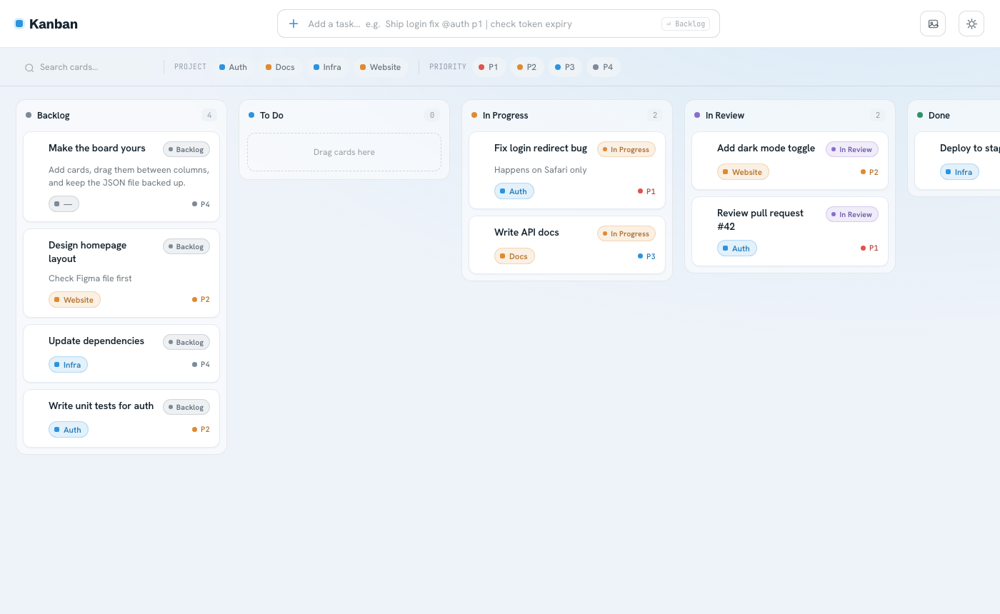
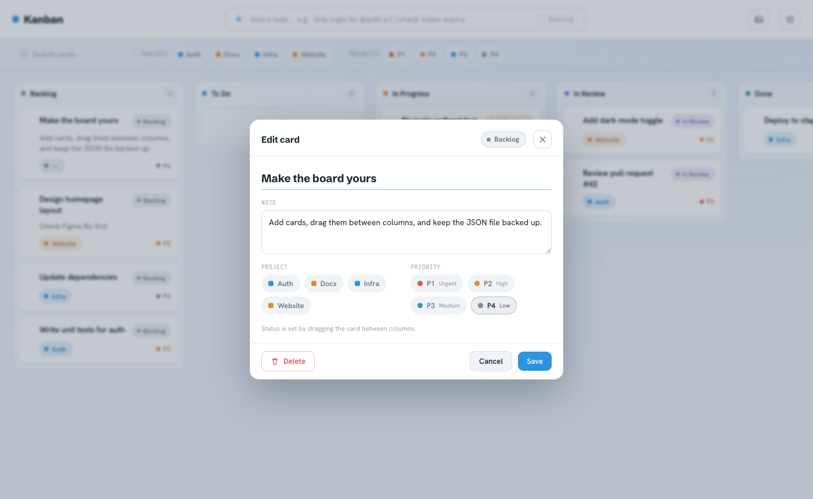
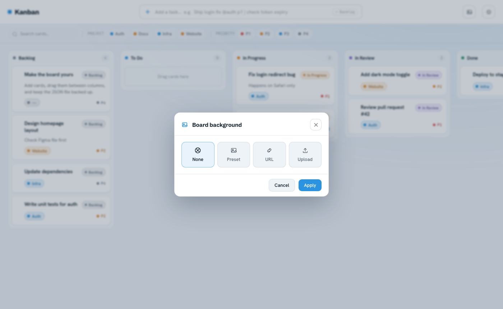
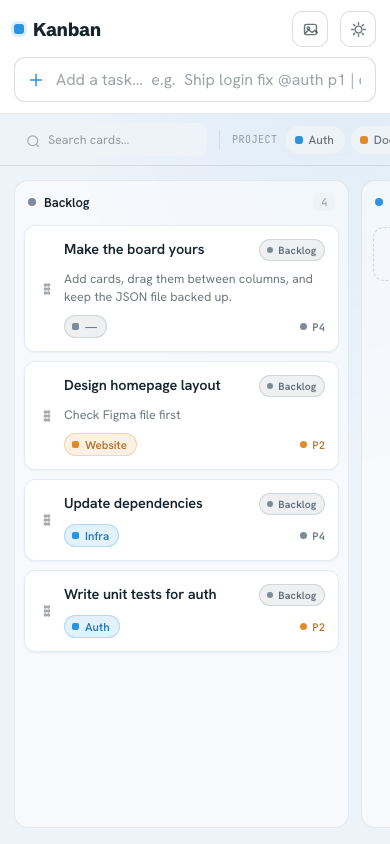

# Kanban

[](https://github.com/euisuh/kanban/actions/workflows/ci.yml)

Minimal self-hosted task board. The goal: something anyone can run in under a minute, with no database, no heavy framework, and no accounts to manage. Board state lives in a single JSON file.

The server is **Python standard library only** — `http.server`, no Flask, no Django, no build step. The frontend is one HTML file, one CSS file, and one vanilla JS file. There is nothing to compile and nothing to install beyond Python itself.



## Features

- **Drag and drop** — move cards between columns with mouse or touch
- **Quick-add** — add tasks from the top bar with inline syntax: `Fix login bug @Auth p1 | happens on Safari`
- **Filters** — search cards by text, filter by project tag or priority
- **Card detail** — click any card to edit title, notes, project, and priority; auto-saves
- **Custom background** — set a background image from a URL or file upload
- **Mobile-friendly** — responsive layout, touch drag, swipe to switch columns
- **Optional auth** — protect the board with HTTP Basic Auth via one environment variable
- **Per-user boards** — each authenticated user gets their own `board.json`
- **Demo mode** — expose a separate public demo board at a different URL without revealing your real data

## Screenshots

<details>
<summary>Card detail</summary>



</details>

<details>
<summary>Background settings</summary>



</details>

<details>
<summary>Mobile</summary>



</details>

## Architecture

```
Browser ──HTTP──► app/server.py ──► app/storage.py ──► data/<user>/board.json
  │                (ThreadingHTTPServer)  (BoardStore)      (atomic writes)
  │                       │
  └── static/ ◄───────────┘  index.html + app.js + styles.css (no build step)
```

- **`app/server.py`** — one `BaseHTTPRequestHandler`. It routes a handful of JSON endpoints, serves the static files, handles HTTP Basic Auth, and validates multipart image uploads (MIME allowlist, magic-byte check, 10 MB cap). Card text is rendered with `textContent` or HTML-escaped, and JSON and static responses carry `X-Content-Type-Options: nosniff`.
- **`app/storage.py`** — `BoardStore` owns the JSON file. Every write goes to a temp file in the same directory, is fsynced, then `os.replace`d over `board.json`, so an interrupted save cannot leave a truncated board behind. Each mutation holds an `RLock` across its load and save, so concurrent requests handled by the threading server do not lose each other's changes (covered by `tests/test_concurrency.py`). The lock is per process: run one server process per data directory. If `board.json` is not valid JSON the server answers 500 and leaves the file untouched.
- **Per-user routing** — when auth is enabled, the authenticated username selects `data/<username>/board.json`. Resolved paths are checked against the data root, so a crafted username cannot escape it. Without auth, everything falls back to a single `KANBAN_DATA` file.

### HTTP API

| Method | Path | Purpose |
| --- | --- | --- |
| `GET` | `/api/board` | Full board: columns, cards, settings |
| `POST` | `/api/cards` | Create a card |
| `PATCH` | `/api/cards/<id>` | Update title, notes, project, priority, column, order |
| `DELETE` | `/api/cards/<id>` | Delete a card |
| `PATCH` | `/api/board/settings` | Update settings (background type/value/fit) |
| `POST` | `/api/upload` | Upload a background image (multipart) |

Errors are JSON `{"error": "..."}`: `400` for invalid input, `404` for an unknown card id, `413` for an upload over 10 MB, `500` for a server-side failure such as an unreadable board file. Input limits: title 200 characters, notes 10,000, project 64, JSON request body 1 MB; `title`, `notes`, and `project` must be strings.

```bash
curl -X POST localhost:8080/api/cards -d '{"title":"Fix login bug","project":"Auth","priority":1,"column":"todo"}'
curl -X PATCH localhost:8080/api/cards/<id> -d '{"column":"doing"}'
```

## Quick start

```bash
git clone https://github.com/euisuh/kanban.git
cd kanban
cp .env.example .env
# edit .env — set KANBAN_CREDENTIAL=yourname:yourpassword
docker compose up -d
```

Open [http://localhost:8097](http://localhost:8097).

## Running locally (without Docker)

No dependencies beyond Python 3.12+:

```bash
python -m app.server
```

Open [http://localhost:8080](http://localhost:8080). The board file is created on first request.

## Configuration

Set options in `.env` (Docker) or the environment (local):

| Variable | Default | Description |
| --- | --- | --- |
| `KANBAN_CREDENTIAL` | — | `username:password` to protect the board. Omit to run without auth. |
| `KANBAN_CREDENTIALS` | — | Comma-separated `user:pass` pairs for multiple users, each with their own board. |
| `KANBAN_DEMO_CREDENTIAL` | — | Optional extra login (e.g. `demo:demo`) that gets its own separate board — useful for sharing a demo at a public URL. |
| `KANBAN_HOST` | `127.0.0.1` | Bind address (the Docker image sets `0.0.0.0`). |
| `KANBAN_PORT` | `8080` | Bind port. |
| `KANBAN_DATA_ROOT` | `data` | Root directory for per-user board files. |
| `KANBAN_DATA` | `data/board.json` | Board file used when auth is disabled. |
| `KANBAN_UPLOADS` | `app/static/uploads` | Where uploaded background images are written. |
| `KANBAN_BASE_PATH` | — | Serve the board under a sub-path (e.g. `/kanban`) behind a reverse proxy. |
| `KANBAN_DEMO_BASE_PATH` | — | Sub-path that auto-logs in as the demo user. |

## Data

Board state is stored in `./data/board.json` (or `./data/<username>/board.json` when auth is on). Back this file up to preserve your board.

```bash
cp data/board.json ~/kanban-backup.json
```

## Project structure

```
app/
  server.py      # HTTP routing, auth, uploads, static file serving
  storage.py     # BoardStore — atomic JSON reads/writes, validation
  static/        # index.html, app.js, styles.css, uploads/
tests/
  test_server.py     # endpoint, auth, upload, and path-safety tests
  test_storage.py    # board normalisation and atomic-write tests
  test_concurrency.py # concurrent writers, corrupt-file handling, input limits
nginx/           # sample TLS reverse proxy config
docs/            # screenshots, design notes
Dockerfile       # python:3.12-slim, non-root user
```

## Tests

```bash
python -m pytest
```

No dependencies beyond `pytest`. CI runs the suite plus a smoke test that boots the server and fetches `/api/board`.

## Nginx (optional)

A sample TLS reverse proxy config is at [`nginx/kanban.conf.example`](nginx/kanban.conf.example).

## Limitations

These are deliberate trade-offs for a single-file, no-database board — worth knowing before you deploy it:

- **HTTP Basic Auth only.** No sessions, no password reset, no OAuth. Passwords come from environment variables. Run it behind TLS.
- **No real-time sync.** Two browsers editing the same card will overwrite each other; the last write wins. There is no websocket and no polling.
- **JSON file, not a database.** The whole file is rewritten on every change. Writes are serialised within one server process only; do not point two processes at the same data directory.
- **No card history, undo, comments, attachments, due dates, or assignees.**
- **Fixed columns.** The five columns (Backlog / To Do / In Progress / In Review / Done) are defined in code and are not editable from the UI.
- **Backups are your job.** Deleting `data/` deletes the board.
- **`http.server` is not a hardened production server.** It is fine on a private network or behind nginx; do not expose it directly to the internet.

## Contributing

Issues and pull requests are welcome.

1. `python -m pytest` must pass — the suite is dependency-free and runs in seconds.
2. Server changes belong in `app/server.py` (routing/auth) or `app/storage.py` (persistence/validation); keep the split.
3. Keep the stdlib-only constraint on the backend and the no-build-step constraint on the frontend. A new dependency needs a reason a few lines of stdlib cannot cover.
4. Commits follow [Conventional Commits](https://www.conventionalcommits.org/).

## Author

Built and maintained by [Euisuh Jeong](https://github.com/euisuh) as a self-hosted replacement for a hosted task board, running on a personal homelab.

## License

MIT — see [LICENSE](LICENSE).
